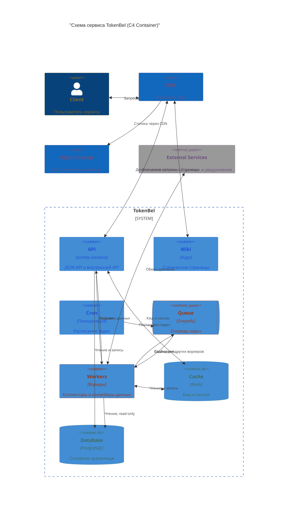

### Схема сервиса

### Хранение данных

В качестве основной базы данных используется [PostgreSQL 18.4](https://www.postgresql.org/). Подключено расширение [pgvector](https://github.com/pgvector/pgvector), которое лежит в основе новой дедупликации событий с помощью эмбеддингов. Для хранения временных данных используется [Redis 8](https://redis.io/).

Вместо собственной сборки PostgreSQL с архитектурой master–slave и PgBouncer теперь используется кластер высокой доступности от провайдера на базе Patroni, etcd, HAProxy и PgBouncer. Переход ускорил обработку запросов и повысил надёжность системы благодаря автоматическому управлению отказоустойчивостью.

Схема таблиц базы данных:

v3

