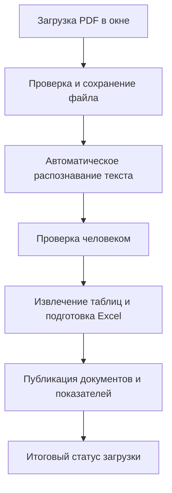

## Введение

Кнопка **«Добавить финансовый отчет компании»** на странице компании позволяет поделиться недостающей финансовой отчётностью: загрузить PDF-документ, указать его тип, год и период, а затем следить за статусом обработки. Это руководство описывает только эту кнопку — поля окна загрузки, правила заполнения и весь путь отчёта: от отправки файла до появления документов и показателей на странице компании.

Загрузка файла не означает мгновенной публикации. Документ последовательно проходит проверку, автоматическое распознавание текста, отдельное решение проверяющего, извлечение таблиц и публикацию. На каждом этапе у загрузки обновляется статус, и его видно в списке «Мои загрузки по этой компании», а все ваши загрузки по всем компаниям собраны в [настройках аккаунта](#все-ваши-загрузки-в-настройках-аккаунта).

---

### Кнопка и окно загрузки

Кнопка **«Добавить финансовый отчет компании»** находится в шапке страницы компании, рядом с её названием, и изображает документ со столбиками. Нажмите её, чтобы открыть окно **«Добавить финансовый отчет»**. Если вы ещё не вошли в аккаунт, вместо окна откроется страница входа: после авторизации вернитесь на страницу компании и нажмите кнопку снова — как зарегистрироваться, описано в статье [«Регистрация и вход»](/guides/rukovodstvo-polzovatelia/registraciia-i-vxod/).

В окне находятся название компании, поля загрузки, сообщения об ошибках и список **«Мои загрузки по этой компании»**. Компания уже выбрана по открытой странице — отдельного поля для её изменения нет. Чтобы загрузить отчёт другой организации, сначала откройте её страницу.

#### Поля формы

1. **Тип отчёта.** Обязательное поле с четырьмя вариантами:
    - **Бухгалтерский баланс** — активы, собственный капитал и обязательства на отчётную дату.
    - **Отчёт о прибылях и убытках** — доходы, расходы и финансовый результат.
    - **Отчёт об изменении собственного капитала** — изменение капитала за период.
    - **Отчет о движении денежных средств** — поступления и выплаты денежных средств.

    Выбирайте форму, которая содержится в PDF, а не ту, чьё название ближе к нужному показателю: от выбора зависит, какие таблицы будут искаться в документе.

2. **Отчетный год.** Обязательное поле. В списке доступны годы от текущего до 2015 включительно; будущий год не принимается.
3. **Период.** Обязательное поле. Выберите I, II или III квартал либо «Годовой». Отдельного IV квартала нет: для годового отчёта выбирайте «Годовой».
4. **PDF-файл (до 1 МБ).** Обязательное поле. Выбирается один документ формата PDF. Точный предел — 1 000 000 байт: файл размером 1 048 576 байт уже превышает его. Подпись поля подсказывает, что отчёт отправится на автоматическое распознавание текста и это может занять до часа.
5. **Комментарий.** Необязательное поле длиной до 2000 символов — например, источник отчёта или пояснение. Если оставить его пустым, к загрузке автоматически добавится стандартное описание (тип отчёта, период и дата отправки).

I квартал относится к окончанию марта, II — июня, III — сентября, годовой отчёт — декабря. Выбирайте период, за который составлен отчёт, а не месяц его скачивания или загрузки.

Ссылка **«сожмите PDF»** в подписи поля открывает внешний сервис сжатия в новой вкладке. После сжатия нужно самостоятельно выбрать полученный файл в форме: сайт не уменьшает документ автоматически.

#### Что проверить в документе

Убедитесь, что это отчёт открытой компании, а выбранные тип и период совпадают с содержимым документа.

Для пользовательских загрузок распознаются **только первые четыре страницы**. Нужные таблицы должны находиться в этой части документа; если они начинаются позже, подготовьте отдельный PDF с нужными страницами, сохранив заголовки, даты, единицы измерения и строки итогов.

Для пополнения финансовых показателей используются суммы в тысячах BYN — тысячах белорусских рублей. Обработка не пересчитывает рубли в тысячи и не переводит валюту отчёта: проверьте единицы исходного документа.

#### Отправка и закрытие окна

Нажмите **«Загрузить отчет»**. Пока идёт отправка, кнопка показывает **«Загружаем...»** и повторное нажатие недоступно; окно в это время закрыть нельзя. После успешной загрузки поля очищаются, список ваших загрузок обновляется, появляется сообщение **«Отчет загружен и отправлен на обработку.»** — это подтверждение приёма файла, а не завершения его публикации.

**«Отмена»**, крестик, щелчок вне окна или клавиша Escape закрывают окно и очищают форму. Закрытие окна после успешной загрузки не отменяет начатую обработку.

#### Почему загрузка может не пройти

Форма проверяет, что заполнены тип, год и период, выбран файл и он не превышает размер; дополнительно проверяется, что загружен настоящий PDF с расширением `.pdf`.

Для одной компании, типа отчёта и периода допускается только одна действующая запись. Новая загрузка не принимается, если:

- такой отчёт уже официально опубликован у компании;
- этот же тип за тот же период уже загружен — вами или другим пользователем — и не находится в статусе «Ошибка обработки».

Разные типы отчётов за один период добавляются независимо друг от друга. Пустой список «Мои загрузки» не означает, что период свободен: чужие загрузки и опубликованные отчёты в нём не показываются.

После статуса «Ошибка обработки» период освобождается, и можно попробовать загрузить исправленный документ снова. Если не удалось сохранить или передать файл на обработку, загрузка также отмечается ошибкой — проверьте список своих загрузок перед повторной попыткой. Сообщение об ошибке показывается в окне; часть текстов может быть на английском языке.

---

### Мои загрузки по этой компании

Внизу окна находятся ваши загрузки по открытой компании, начиная с последних. Для каждой показаны тип отчёта, период, год и текущий статус.

Нажатие на название открывает загруженный вами исходный PDF в новой вкладке. Ссылка ведёт к оригиналу документа, а не к таблице распознанных данных.

Список обновляется при открытии окна и после каждой новой загрузки; сам по себе он за статусами не следит. Чтобы увидеть свежий статус, закройте и снова откройте окно. Во время обновления показывается **«Загрузка…»**, пустой список сопровождается сообщением **«Вы еще не загружали отчеты для этой компании.»**.

#### Что означают статусы

| Статус в окне                 | Что он означает                                                                                                                |
| ----------------------------- | ------------------------------------------------------------------------------------------------------------------------------ |
| «Загружен, ожидает обработки» | Файл принят и сохранён. Распознавание ещё не подтверждено: заявка может ожидать своей группы или уже распознаваться.           |
| «Обработан / на проверке»     | Текст успешно распознан и сохранён. Документ ожидает отдельного решения проверяющего; показатели компании пока не публикуются. |
| «Отправлен на обработку»      | Проверяющий разрешил продолжить: документ передан на извлечение таблиц и публикацию результата.                                |
| «Решена»                      | Обработка полностью завершена, публикация документов и данных подтверждена.                                                    |
| «Ошибка обработки»            | На одном из этапов произошёл сбой. При сохранённой причине она показывается при наведении курсора на статус.                   |

Не у каждого этапа есть собственная подпись: поиск таблиц, подготовка Excel и сохранение документов внутри одного статуса не различаются. Отсутствие смены статуса в открытом окне также может означать, что список просто не обновлялся.

---

### Все ваши загрузки в настройках аккаунта

Полная история ваших загрузок по всем компаниям собрана на [странице настроек аккаунта](https://dashboard.tokenbel.info/profile/settings), на вкладке **«Обращения и загрузки»** — рядом с обращениями по качеству данных. Подробнее о настройках аккаунта рассказано в статье [«Личный кабинет»](/guides/rukovodstvo-polzovatelia/licnyi-kabinet/).

Для каждой загрузки в таблице показаны:

* **Тип** — тип обращения или отчёта, например «Бухгалтерский баланс»;
* **Статус** — те же статусы обработки, что и в окне загрузки;
* **Награда** — начисленные баллы, если загрузка была вознаграждена;
* **Объект** — компания, к которой относится загрузка;
* **Детали** — период отчёта и ссылки на исходный **PDF** и распознанный текст **OCR (MD)**;
* **Дата** — когда была отправлена загрузка.

Список в настройках удобен, когда загрузок много: здесь видно состояние всех ваших отчётов сразу, без перехода на страницы отдельных компаний. Ссылки из колонки «Детали» открывают документы в новой вкладке и ведут к тем же файлам, что и в окне загрузки.

---

### Как проходит обработка отчёта

Путь пользовательского отчёта состоит из четырёх этапов: приём заявки, автоматическое распознавание, проверка человеком и извлечение данных с публикацией. Между распознаванием и извлечением всегда стоит отдельное разрешение проверяющего.

Если любой этап завершается ошибкой, отчёт не переходит к следующему шагу успешного пути, а загрузка получает статус «Ошибка обработки» (когда сбой удаётся зафиксировать). Ниже каждый шаг описан подробнее.

#### Этап 1. Проверка заявки

Проверяются выбранная компания, тип отчёта, год, период, формат и размер файла. Затем — не занят ли этот тип отчёта за тот же период опубликованным отчётом или чужой действующей загрузкой.

Выбранные вами компания, тип и период сопровождают документ на всём пути: автоматика не исправляет ошибочный выбор в форме.

#### Этап 2. Сохранение исходного PDF

Для принятой заявки создаётся запись вашей загрузки со статусом «Загружен, ожидает обработки», исходный файл сохраняется в неизменном виде, и документ ставится в очередь на распознавание.

Оригинал нужен для двух целей: открыть PDF из списка загрузок и позже приложить исходник к опубликованным документам компании. Успешное сохранение файла ещё не означает, что его таблицы удастся прочитать.

Если сохранить файл или передать его на распознавание не удалось, загрузка получает «Ошибка обработки», а период освобождается для повторной попытки.

#### Этап 3. Ожидание группы и распознавание

Загруженные файлы объединяются в общую группу с документами других пользователей (до 100 файлов, накопление — до 10 минут) и отправляются на распознавание одной партией. Это экономит ресурсы, но каждый файл в группе оценивается отдельно.

Распознавание превращает текст и таблицы **первых четырёх страниц** PDF в текстовое представление:

- изображения и картинки в результат не переносятся;
- верхние и нижние колонтитулы страниц отделяются от основного содержимого и в таблицы не попадают;
- страницы после четвёртой не распознаются ни сейчас, ни позже.

Задача этапа — прочитать документ. Здесь не рассчитываются коэффициенты и не добавляются показатели компании.

#### Этап 4. Готовность результата и статус

Готовность группы проверяется примерно раз в 10 минут. Успех группы в целом не означает, что распознан каждый файл: результат проверяется индивидуально для вашего документа. «Ошибка обработки» возникает, если распознавание не удалось, результат пуст, отсутствует, отменено, не уложилось в отведённое время — или если распознанный текст превысил допустимый объём (около 1 МБ текста).

Успешно распознанный текст сохраняется отдельно от исходного PDF, и только после сохранения загрузка переводится в **«Обработан / на проверке»**. Если доставка результата задержалась, система может повторить попытку позже в пределах суток — повторную загрузку файла при этом делать не нужно.

#### Этап 5. Проверка и разрешение

Проверяющий просматривает распознанный текст и решает, передавать ли документ дальше. Автоматически следующий этап не запускается, и повторное нажатие «Загрузить отчет» его тоже не запускает.

Перед передачей система дополнительно убеждается, что исходный PDF и распознанный текст принадлежат именно этой заявке и этой компании. После разрешения загрузка получает статус **«Отправлен на обработку»**. На этом шаге ещё ничего не публикуется — он лишь открывает путь дальше.

#### Этап 6. Чтение распознанного текста

Дальнейшая обработка использует уже сохранённый текст; исходный PDF заново не распознаётся. Проверяется, что текст доступен и не превышает допустимый объём. Если получить его нельзя, извлечение таблиц не начинается.

Дальнейшие задания обрабатываются строго по одному, поэтому перед публикацией возможна очередь из других документов.

#### Этап 7. Поиск финансовых таблиц

Из текста убирается служебное оформление, оставшееся от распознавания, — лишние пустые колонки, попавшие в таблицу сведения о компании и подобные артефакты. Затем выделяются таблицы, похожие на бухгалтерские формы:

- таблица должна содержать не менее трёх столбцов и трёх строк данных;
- в шапке должен быть финансовый заголовок либо в таблице должно быть не менее трёх строк с кодами строк;
- продолжение таблицы на следующей распознанной странице присоединяется к предыдущей, если оно идёт без нового заголовка и содержит строки с кодами.

Слишком короткие или неподходящие таблицы отбрасываются. Если пригодных таблиц не нашлось, обработка завершается ошибкой. Такой отбор подтверждает, что таблица похожа на финансовую, но не проверяет достоверность её цифр.

#### Этап 8. Подготовка строк, дат и чисел

В подходящих таблицах находится столбец кодов строк. В итоговые данные проходят строки с двух- или трёхзначными числовыми кодами; пояснительные строки и строки без подходящего кода не переносятся.

Даты в заголовках столбцов приводятся к месяцу и году, когда в заголовке удаётся распознать название месяца и год. Неоднозначная дата автоматически не исправляется подбором периода из формы — для баланса непонятные даты могут помешать публикации.

При подготовке сумм:

- пробелы между разрядами убираются (`5 622` → `5622`);
- число в круглых скобках считается отрицательным (`(4 218)` → `-4218`);
- пустая ячейка или прочерк становятся нулём;
- сохраняется целая часть числа до запятой (`1 986,99` → `1986`);
- значение, которое не удалось разобрать, тоже может превратиться в ноль.

Поэтому итоговая таблица — не точная копия оформления и дробных значений исходника, а спорные числа стоит сверять с PDF. Валюта не пересчитывается: значения остаются в тех единицах, в которых составлен отчёт.

#### Этап 9. Подготовка Excel

Очищенные таблицы собираются в один Excel-документ выбранного типа отчёта: коды строк, столбцы периодов и подготовленные значения. Это табличная версия вашего отчёта, а не копия исходного PDF.

Если после очистки не осталось пригодных строк или Excel не удалось подготовить, публикация не продолжается.

#### Этап 10. Подготовка исходника к публикации

Исходный PDF копируется к документам компании. Ваша первоначальная копия при этом не удаляется. Если исходник отсутствует, пуст или его не удалось сохранить рядом с документами компании, успешная публикация не подтверждается.

При повторной обработке уже существующий непустой PDF компании сохраняется, а не заменяется новой копией.

#### Этап 11. Проверка перед публикацией

Проверяются пригодность подготовленного Excel, его допустимый размер (не более 2 МБ) и наличие исходного PDF. Для бухгалтерского баланса дополнительно проверяются даты и шесть обязательных итоговых строк:

| Код строки баланса | Какой показатель извлекается |
| ------------------ | ---------------------------- |
| 190                | Долгосрочные активы          |
| 290                | Краткосрочные активы         |
| 490                | Собственный капитал          |
| 590                | Долгосрочные обязательства   |
| 690                | Краткосрочные обязательства  |
| 700                | Баланс                       |

Все шесть итогов нужны для каждого распознанного столбца периода, и выбранный в форме отчётный период обязан присутствовать в результате. Итоги должны быть числами, а не пустыми ячейками. Если одна итоговая строка за период встречается несколько раз, одинаковые значения допустимы, а противоречащие друг другу — нет.

Сравнительные данные за прошлые периоды, приведённые в отчёте, проверяются по тем же правилам: ошибка в сравнительном столбце может остановить публикацию всего баланса. Пропущенные итоги не восстанавливаются автоматическим расчётом из других строк, а ноль, возникший при распознавании, остаётся нулём — сверяйте важные суммы с исходником.

#### Этап 12. Публикация документов и данных

После успешной проверки к компании добавляются ссылки на исходный PDF и подготовленный Excel — они становятся частью раздела финансовой отчётности на странице компании.

Для **бухгалтерского баланса** дополнительно добавляются отсутствующие значения шести показателей; уже опубликованные значения не перезаписываются. Из одного отчёта могут добавиться показатели не только выбранного периода, но и прошлых — из сравнительных столбцов. После добавления балансовых данных пересчитываются расчётные коэффициенты компании. Регистрация документов, добавление показателей и обновление коэффициентов выполняются как единое изменение: при сбое эта часть публикации не подтверждается.

Для остальных трёх типов отчётов публикуются документы и подготовленные таблицы; их строки шесть балансовых показателей и графики автоматически не пополняют.

Повторная публикация не заменяет уже зарегистрированные документы и показатели.

#### Этап 13. Итоговый статус

После подтверждённой публикации загрузка получает статус **«Решена»**. При ошибке извлечения таблиц, подготовки документов или публикации — **«Ошибка обработки»**, если отметку удалось доставить.

Публикация данных и изменение статуса — отдельные действия, поэтому документы у компании могут появиться раньше, чем список загрузок сменит «Отправлен на обработку». Ошибка обновления статуса не отменяет успешно опубликованные данные.

---

### Если отчёт долго не меняет статус

Сначала заново откройте окно загрузок: оставленный открытым список сам не обновляется. Затем проверьте раздел финансовой отчётности компании — не появились ли документы нужного периода.

- **«Загружен, ожидает обработки».** Результат распознавания ещё не подтверждён: заявка копит общую группу и проверяется периодически, раз в несколько минут.
- **«Обработан / на проверке».** Распознавание завершено; для продолжения требуется решение проверяющего — это может занимать время.
- **«Отправлен на обработку».** Идёт извлечение таблиц и публикация либо ещё не доставлена итоговая отметка; перед публикацией возможна очередь из других документов.
- **«Решена», но новых показателей нет.** Проверьте тип отчёта: только баланс автоматически пополняет финансовые показатели. Уже опубликованные значения не заменяются, а новые данные могут отобразиться через несколько минут после обновления страницы.
- **Ошибка обработки.** Наведите курсор на статус, чтобы увидеть причину, если она сохранена. Проверьте читаемость таблиц, первые четыре страницы, выбранные тип и период; после этого период свободен для новой загрузки.

Кнопки повторного запуска или редактирования принятой заявки в окне нет. Если статус долго не меняется или непонятно, опубликован ли результат, сообщите об этом команде сервиса, указав компанию, тип отчёта, год, период и текущий статус. Не выбирайте заведомо неверные год или тип, чтобы обойти запрет повторной загрузки.

---

## Краткий глоссарий

- **Финансовая отчётность** — документы о финансовом положении и результатах деятельности компании за определённый период.
- **Бухгалтерский баланс** — отчёт об активах, собственном капитале и обязательствах, из которого здесь извлекаются основные финансовые показатели.
- **Отчётный период** — квартал или год, к которому относится загружаемый документ.
- **Распознавание документа** — автоматическое преобразование текста и таблиц из PDF в читаемый текст для дальнейшей обработки.
- **Сравнительные данные** — значения прошлых периодов, приведённые в отчёте рядом с текущими.
- **Финансовый коэффициент** — соотношение показателей баланса, которое пересчитывается после добавления новых балансовых данных.
